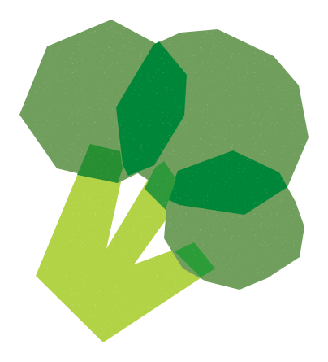
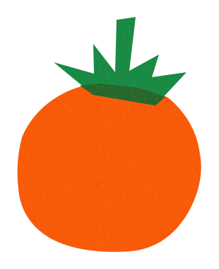
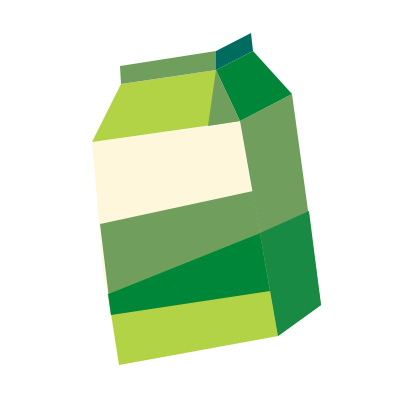
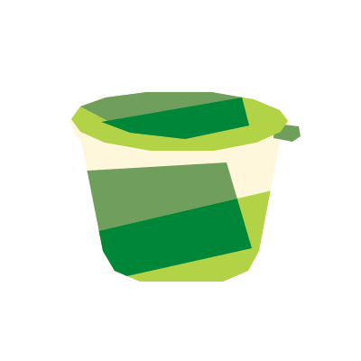

# Geometric Cut Paper

A reusable Codex skill for a geometric cut-paper illustration style. It combines broad shapes, soft curves and clipped edges, layered color planes, subtle grain, and transparent backgrounds in editable SVG artwork.

  
  
  
  

## Install

Copy this folder into your Codex skills directory as `geometric-cut-paper`. Invoke it with `$geometric-cut-paper`.

The `assets/` folder contains the palette, reusable vector components, and style references. See `SKILL.md` for the workflow and `references/style-guide.md` for the visual rules.
